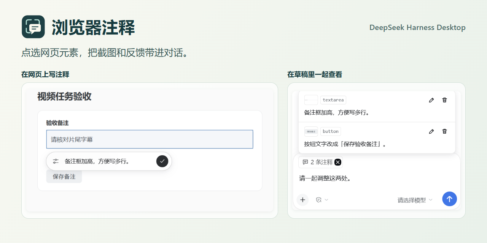

# 浏览器注释 · Browser Annotations

在 DeepSeek Harness 桌面端的右侧浏览器点选网页元素，就地写下反馈。每条注释会把选区截图、标出位置的可视区截图和文字放进当前对话草稿，你可以补充要求后一起发送。



## 安装

在 DSH 的「插件」中启用实验性功能「自定义插件索引」，打开「发现」→「添加索引源」，粘贴下面的地址。打开「浏览器注释」卡片，确认版本和来源后安装。此索引由本插件维护者提供。

```text
https://raw.githubusercontent.com/baiger01/dsh-browser-annotations/main/index.json
```

Windows 也可从 [Releases](https://github.com/baiger01/dsh-browser-annotations/releases/tag/v0.2.2) 下载 `dsh-browser-annotations-0.2.2.tgz`，在下载目录打开 PowerShell 安装。

```powershell
$cli = Join-Path $env:LOCALAPPDATA 'Programs\DeepSeek Harness\resources\runtime\cli\bin\dsh.cmd'
$bundle = (Resolve-Path '.\dsh-browser-annotations-0.2.2.tgz').Path
& $cli plugin --profile desktop add "file:$bundle"
```

## 使用

1. 在右侧 Browser 面板打开网页，点工具栏的「注释」。移动鼠标预览元素边框，再点一下锁定元素；跨元素反馈也可以拖出矩形。
2. 在选区旁输入注释，点 ✓ 加入草稿。左侧选项可以重选或「保存并继续」。Enter 换行，Ctrl + Enter 保存。Esc 收起选项或退出选取。
3. 点对话框上方的「N 条注释」展开卡片，检查缩略图、元素标签和文字。铅笔可以改文字，垃圾桶可以删除该条注释及其两张图。
4. 在对话框里补充要求，用 DSH 原有的发送按钮一起提交。

[查看元素选择实机截图](https://raw.githubusercontent.com/baiger01/dsh-browser-annotations/v0.2.2/media/select-element.png) · [查看草稿卡片实机截图](https://raw.githubusercontent.com/baiger01/dsh-browser-annotations/v0.2.2/media/review-notes.png)

## 兼容性与数据

- 已在 Windows 版 DeepSeek Harness Desktop `0.2.2-rc.5` 的内置浏览器验证。需要启用浏览器侧栏，并使用可接收图片的对话。
- 元素选取支持同源 iframe 和开放的 Shadow DOM。跨域 iframe 可作为整体选择。
- 每条注释保留同一时刻的选区图和可视区图，并附上注释文字、网页 URL，以及点选元素时取得的定位信息。发送前可展开草稿核对；发送后的数据处理沿用 DSH 及当前模型服务的配置。
- 截图附件保存在当前应用运行期间。完全退出后若恢复的草稿只剩文字，需要重新标注以补回图片。

## English

Browser Annotations adds element picking to the right-hand browser in DeepSeek Harness Desktop. Click an element or drag across an area, write a note, then save it to the active chat draft. Review or remove individual notes before sending. Each one includes a clean crop, a marked viewport image and the page context. Tested on Windows with DSH Desktop 0.2.2-rc.5.
